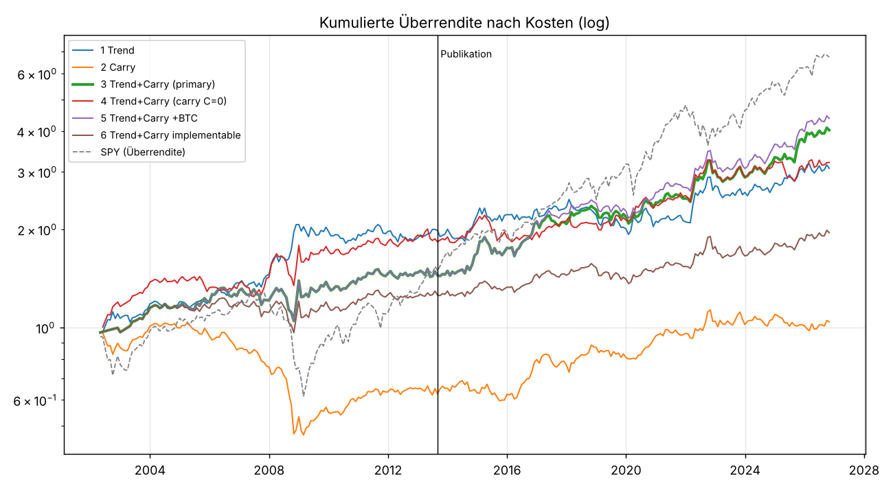

# Resultate: Trend + Carry

Daten bis 2026-11-20 · Auswertung ab 2002-04 (erster Monat, in dem alle Varianten investiert sind).
Alle Renditen sind **monatliche Überrenditen über dem T-Bill-Satz, nach Transaktionskosten**.
Parameter gemäss [PREREGISTRATION.md](../PREREGISTRATION.md) – nicht nachträglich verändert.

## Vorab definiertes Erfolgskriterium

Primärvariante, nach Publikation, netto: Sharpe = **0.77**, PSR(0) = **1.00** → **ERFÜLLT** (verlangt: Sharpe > 0 und PSR(0) > 0.95).

## Gesamt

| Variante | Zeitraum | Rendite p.a. | Vol. | Sharpe | t-Wert | Max. DD | Schlechtester Monat | Schiefe | Korr. SPY | PSR(0) | DSR (N=6) |
|---|---|---|---|---|---|---|---|---|---|---|---|
| 1 Trend | 2002-04–2026-10 | 5.1 % | 10.6 % | 0.48 | 2.40 | -21.9 % | -9.0 % | 0.62 | -0.25 | 0.99 | 0.87 |
| 2 Carry | 2002-04–2026-10 | 0.7 % | 10.2 % | 0.07 | 0.34 | -54.6 % | -18.5 % | -0.84 | 0.21 | 0.63 | 0.17 |
| 3 Trend+Carry (primary) | 2002-04–2026-10 | 6.5 % | 11.1 % | 0.58 | 2.84 | -20.8 % | -11.0 % | 0.68 | -0.03 | 1.00 | 0.95 |
| 4 Trend+Carry (carry C=0) | 2002-05–2026-10 | 5.4 % | 10.8 % | 0.50 | 2.46 | -20.1 % | -11.0 % | 0.64 | -0.00 | 0.99 | 0.89 |
| 5 Trend+Carry +BTC | 2002-04–2026-10 | 6.8 % | 11.0 % | 0.62 | 3.03 | -20.8 % | -11.0 % | 0.63 | -0.02 | 1.00 | 0.96 |
| 6 Trend+Carry implementable | 2002-04–2026-10 | 3.2 % | 8.8 % | 0.36 | 1.77 | -21.7 % | -11.0 % | 0.14 | -0.03 | 0.96 | 0.69 |
| *SPY (Benchmark)* | 2002-04–2026-10 | 8.9 % | 14.8 % | 0.60 | 2.97 | -51.8 % | -16.6 % | -0.52 | 1.00 | 1.00 | – |

## Vor Publikation (< 2013-09-01)

| Variante | Zeitraum | Rendite p.a. | Vol. | Sharpe | t-Wert | Max. DD | Schlechtester Monat | Schiefe | Korr. SPY | PSR(0) | DSR (N=6) |
|---|---|---|---|---|---|---|---|---|---|---|---|
| 1 Trend | 2002-04–2013-08 | 6.5 % | 9.7 % | 0.67 | 2.26 | -12.5 % | -4.7 % | 0.89 | -0.28 | 0.99 | 0.80 |
| 2 Carry | 2002-04–2013-08 | -3.5 % | 11.1 % | -0.31 | -1.06 | -54.6 % | -18.5 % | -1.47 | 0.60 | 0.13 | 0.00 |
| 3 Trend+Carry (primary) | 2002-04–2013-08 | 4.1 % | 11.3 % | 0.36 | 1.18 | -20.8 % | -11.0 % | 1.11 | 0.22 | 0.89 | 0.39 |
| 4 Trend+Carry (carry C=0) | 2002-05–2013-08 | 6.3 % | 11.8 % | 0.53 | 1.75 | -20.1 % | -11.0 % | 1.05 | 0.09 | 0.97 | 0.62 |
| 5 Trend+Carry +BTC | 2002-04–2013-08 | 4.1 % | 11.3 % | 0.36 | 1.18 | -20.8 % | -11.0 % | 1.11 | 0.22 | 0.89 | 0.39 |
| 6 Trend+Carry implementable | 2002-04–2013-08 | 2.6 % | 9.9 % | 0.27 | 0.87 | -21.7 % | -11.0 % | 0.29 | 0.26 | 0.81 | 0.29 |
| *SPY (Benchmark)* | 2002-04–2013-08 | 4.7 % | 15.4 % | 0.31 | 1.04 | -51.8 % | -16.6 % | -0.63 | 1.00 | 0.84 | – |

## **Nach Publikation (≥ 2013-09-01) – massgebend**

| Variante | Zeitraum | Rendite p.a. | Vol. | Sharpe | t-Wert | Max. DD | Schlechtester Monat | Schiefe | Korr. SPY | PSR(0) | DSR (N=6) |
|---|---|---|---|---|---|---|---|---|---|---|---|
| 1 Trend | 2013-09–2026-10 | 4.0 % | 11.3 % | 0.35 | 1.27 | -21.9 % | -9.0 % | 0.50 | -0.23 | 0.90 | 0.63 |
| 2 Carry | 2013-09–2026-10 | 4.3 % | 9.4 % | 0.46 | 1.66 | -13.6 % | -7.8 % | 0.15 | -0.23 | 0.95 | 0.77 |
| 3 Trend+Carry (primary) | 2013-09–2026-10 | 8.4 % | 10.9 % | 0.77 | 2.80 | -13.9 % | -8.5 % | 0.30 | -0.25 | 1.00 | 0.97 |
| 4 Trend+Carry (carry C=0) | 2013-09–2026-10 | 4.8 % | 10.0 % | 0.47 | 1.72 | -17.1 % | -8.3 % | 0.06 | -0.10 | 0.96 | 0.78 |
| 5 Trend+Carry +BTC | 2013-09–2026-10 | 9.0 % | 10.6 % | 0.85 | 3.07 | -13.9 % | -8.2 % | 0.19 | -0.24 | 1.00 | 0.98 |
| 6 Trend+Carry implementable | 2013-09–2026-10 | 3.6 % | 7.9 % | 0.46 | 1.68 | -14.1 % | -8.5 % | -0.09 | -0.33 | 0.95 | 0.77 |
| *SPY (Benchmark)* | 2013-09–2026-10 | 12.5 % | 14.3 % | 0.87 | 3.17 | -24.7 % | -12.5 % | -0.37 | 1.00 | 1.00 | – |

## Hebel und Kosten (nach Publikation)

| Variante | Ø Brutto-Hebel | Max. Brutto-Hebel | Ø Netto-Exposure | Ø Kosten p.a. |
|---|---|---|---|---|
| 1 Trend | 2.31 | 5.77 | -0.24 | 2.20 % |
| 2 Carry | 2.86 | 7.06 | -0.79 | 0.47 % |
| 3 Trend+Carry (primary) | 2.94 | 6.40 | -0.62 | 2.06 % |
| 4 Trend+Carry (carry C=0) | 2.82 | 7.69 | -0.14 | 1.89 % |
| 5 Trend+Carry +BTC | 2.85 | 6.40 | -0.62 | 1.99 % |
| 6 Trend+Carry implementable | 1.91 | 2.00 | -0.53 | 1.22 % |

## Rendite-Beitrag nach Anlageklasse (nach Publikation, vor Kosten, p.a.)

| Variante | bond | commodity | crypto | equity | fx |
|---|---|---|---|---|---|
| 1 Trend | 0.4 % | 2.0 % | 0.0 % | 2.0 % | 1.7 % |
| 2 Carry | 2.5 % | 0.0 % | 0.0 % | 1.5 % | 0.8 % |
| 3 Trend+Carry (primary) | 2.1 % | 2.6 % | 0.0 % | 3.6 % | 2.1 % |
| 4 Trend+Carry (carry C=0) | 0.3 % | 1.8 % | 0.0 % | 1.3 % | 3.2 % |
| 5 Trend+Carry +BTC | 2.2 % | 2.5 % | 1.1 % | 3.2 % | 2.0 % |
| 6 Trend+Carry implementable | 0.9 % | 1.3 % | 0.0 % | 1.8 % | 1.6 % |

## Verhalten in den schlechtesten 10 % der SPY-Monate (nach Publikation)

| Variante | Ø Monatsrendite | SPY Ø im selben Monat |
|---|---|---|
| 1 Trend | 1.95 % | -7.09 % |
| 2 Carry | 1.56 % | -7.09 % |
| 3 Trend+Carry (primary) | 1.90 % | -7.09 % |
| 4 Trend+Carry (carry C=0) | 1.33 % | -7.09 % |
| 5 Trend+Carry +BTC | 1.82 % | -7.09 % |
| 6 Trend+Carry implementable | 1.71 % | -7.09 % |

## Jahresrenditen (Überrendite, netto)

„Instr.“ = durchschnittliche Anzahl Instrumente mit Position in der Primärvariante (früh im Datensatz existieren viele ETFs noch nicht).

| Jahr | Instr. | 1 Trend | 2 Carry | 3 Trend+Carry (primary) | 4 Trend+Carry (carry C=0) | 5 Trend+Carry +BTC | 6 Trend+Carry implementable | SPY |
|---|---|---|---|---|---|---|---|---|
| 2002 | 1 | 6.8 % | -13.2 % | -3.3 % | 16.0 % | -3.3 % | -3.3 % | -22.9 % |
| 2003 | 1 | 10.7 % | 16.4 % | 18.8 % | 18.8 % | 18.8 % | 18.8 % | 26.9 % |
| 2004 | 3 | 1.5 % | -1.4 % | 1.4 % | 2.2 % | 1.4 % | 0.6 % | 9.2 % |
| 2005 | 5 | 1.0 % | -5.6 % | 2.6 % | -5.9 % | 2.6 % | -0.9 % | 1.6 % |
| 2006 | 5 | 13.0 % | -8.4 % | 8.4 % | 3.0 % | 8.4 % | 3.5 % | 10.6 % |
| 2007 | 6 | 6.1 % | -12.2 % | -6.5 % | 4.5 % | -6.5 % | -6.1 % | 0.7 % |
| 2008 | 9 | 42.4 % | -29.5 % | 14.9 % | 25.3 % | 14.9 % | 8.2 % | -37.7 % |
| 2009 | 13 | -4.9 % | 2.8 % | -4.4 % | -3.9 % | -4.4 % | -4.0 % | 26.2 % |
| 2010 | 13 | -2.0 % | 11.3 % | 6.4 % | 3.4 % | 6.4 % | 5.7 % | 14.9 % |
| 2011 | 13 | 2.1 % | 3.9 % | 3.4 % | 3.0 % | 3.4 % | 3.3 % | 1.8 % |
| 2012 | 13 | -4.4 % | 2.4 % | 0.7 % | 5.0 % | 0.7 % | -1.0 % | 15.9 % |
| 2013 | 13 | 6.2 % | 0.3 % | 1.2 % | -1.4 % | 1.2 % | 3.6 % | 32.2 % |
| 2014 | 13 | 10.7 % | -3.3 % | 13.5 % | 12.3 % | 13.5 % | 3.0 % | 13.4 % |
| 2015 | 13 | 0.2 % | -0.8 % | 3.7 % | -11.3 % | 3.7 % | -0.2 % | 1.2 % |
| 2016 | 13 | 4.0 % | 27.7 % | 20.4 % | 3.8 % | 21.3 % | 9.5 % | 11.7 % |
| 2017 | 13 | 1.3 % | -3.9 % | -1.7 % | 8.5 % | 4.8 % | -0.7 % | 20.6 % |
| 2018 | 13 | -5.6 % | 13.1 % | 10.5 % | -2.0 % | 7.7 % | 5.4 % | -6.4 % |
| 2019 | 13 | -9.2 % | -6.8 % | -4.8 % | 2.3 % | -5.4 % | -7.8 % | 28.6 % |
| 2020 | 13 | 5.5 % | 16.5 % | 10.6 % | 11.7 % | 14.2 % | 7.7 % | 17.9 % |
| 2021 | 13 | -0.4 % | 1.8 % | 3.0 % | 6.5 % | 3.5 % | 1.6 % | 28.7 % |
| 2022 | 13 | 29.0 % | 9.0 % | 21.7 % | 19.7 % | 20.7 % | 15.1 % | -19.8 % |
| 2023 | 13 | -4.6 % | -2.4 % | -4.7 % | -4.7 % | -5.3 % | -6.4 % | 20.1 % |
| 2024 | 13 | 6.8 % | 7.4 % | 15.3 % | 11.7 % | 18.8 % | 9.3 % | 18.9 % |
| 2025 | 13 | 7.9 % | -7.7 % | 11.3 % | -6.0 % | 9.2 % | 1.7 % | 13.1 % |
| 2026 | 13 | 2.9 % | 2.8 % | 8.7 % | 5.5 % | 9.8 % | 5.9 % | 8.3 % |

## Aktuelle Zielgewichte (Signal vom 2026-11-19, Anteil am Kapital)

| Ticker | 3 Trend+Carry (primary) | 6 Trend+Carry implementable |
|---|---|---|
| SPY | -4.6 % | -4.6 % |
| EFA | -4.5 % | -4.5 % |
| EEM | -2.7 % | -2.7 % |
| IEF | -12.9 % | -12.9 % |
| TLT | -7.1 % | -7.1 % |
| GLD | -2.5 % | -2.5 % |
| DBC | -1.0 % | -1.0 % |
| FXE | -22.5 % | -22.5 % |
| FXY | -15.3 % | -15.3 % |
| FXB | -20.5 % | -20.5 % |
| FXA | -15.0 % | -15.0 % |
| FXC | -26.4 % | -26.4 % |
| FXF | -17.1 % | -17.1 % |
| **Brutto-Hebel** | 1.52 | 1.52 |

